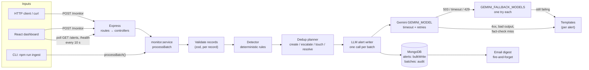

# Intelligent API Monitoring & Alert System

A Node.js service that ingests batches of API response metrics (status code, latency, records returned) over `POST /monitor` or from a JSON file.
Deterministic rules detect anomalies (failures, slow responses, missing or zero data) and group them into one alert per API.
Gemini writes the human-readable alert text, with retries, fallback models and template fallback, so ingestion never depends on the LLM.
Alerts are stored in MongoDB, served on `GET /alerts`, optionally emailed as a digest, and shown in a React dashboard that polls for changes.
Repeated reports update the same alert, worsening ones escalate it, and a healthy observation resolves it automatically.

**Contents:** [Architecture](#architecture) · [Design decisions](#key-design-decisions) · [Spec ambiguities](#spec-ambiguities-and-the-choices-made) · [Setup](#setup) · [Environment variables](#environment-variables) · [Running](#running) · [API reference](#api-reference) · [Testing](#testing) · [Known limitations](#known-limitations-and-future-work)

---

## Architecture



Request flow for one batch (`backend/src/services/monitor.service.js`):

1. **Validate.** Each record is checked on its own. A record without a usable `api_name` is *rejected* and reported back. A record with malformed metrics is *accepted* and flagged `INVALID_PAYLOAD`.
2. **Detect.** Pure rule functions produce **one finding per API** per batch, listing every anomaly that fired.
3. **Plan.** The current active alerts are loaded with one `$in` query. A pure planner then decides, per API, whether to **create**, **escalate**, **touch** (seen again), count a **healthy** observation, or **resolve**.
4. **Write text.** **One** LLM call covers only the created and escalated alerts. Its output is schema-checked and **fact-checked**, and any item that fails falls back to a template.
5. **Persist.** One unordered `bulkWrite` applies the plan. A `Batch` audit document records the counts and the LLM outcome.
6. **Notify.** An email digest of new and escalated alerts is sent in the background.

```
backend/
  src/
    config/env.js           zod-validated env -> frozen config (fails fast, never prints values)
    routes/ controllers/    thin HTTP layer (no business logic)
    schemas/                request + observation validation
    services/
      detection/            rules.js, detector.js      (pure)
      alerts/               dedup.js (pure planner), alert.service.js (bulkWrite, queries)
      llm/                  prompt, geminiClient, retry, factCheck, templates, alertWriter
      notify/               digest.js (pure), email.service.js
      monitor.service.js    orchestrates one batch (HTTP and CLI)
    models/                 Alert, Batch
    cli/                    ingest-file.js, db-reset.js
  fixtures/                 sample-batch.json, mixed.json, recovery.json
  tests/                    unit + integration (mongodb-memory-server)
frontend/
  src/api/                  fetch client + TanStack Query hooks
  src/components/           dashboard components
  src/lib/                  filters (URL), formatting, severity, hooks
  tests/
```

---

## Key design decisions

**Rules detect; the LLM only writes.** Whether something is an anomaly, and how severe it is, is decided by deterministic, configurable rules. The LLM never sees a raw record and cannot change a severity: it receives already-classified findings and writes the title, message and suggested action.

| Category | Rule | Condition | Severity |
|---|---|---|---|
| AVAILABILITY | `HTTP_5XX` | status ≥ 500 | critical |
| AVAILABILITY | `HTTP_AUTH` | 401 or 403 | high |
| AVAILABILITY | `HTTP_RATE_LIMITED` | 429 | medium |
| AVAILABILITY | `HTTP_4XX` | other 4xx | high |
| AVAILABILITY | `UNEXPECTED_STATUS` | 1xx or 3xx | medium |
| LATENCY | `LATENCY_CRITICAL` | ≥ `LATENCY_CRITICAL_MS` (5000) | high |
| LATENCY | `LATENCY_WARNING` | ≥ `LATENCY_WARNING_MS` (2000) | medium |
| DATA | `INVALID_PAYLOAD` | known API, malformed metric fields | high |
| DATA | `RECORDS_MISSING` | 2xx without `records_returned` | high |
| DATA | `ZERO_RECORDS` | 2xx with `records_returned: 0` | medium |

- Within each category only the most severe rule applies, and the alert's severity is the highest across categories.
- DATA rules are skipped when the request itself failed, because zero records from a 500 is a symptom, not a separate problem. The record count still appears in the alert text.

**One alert per API.** Alerts are keyed by a fingerprint: the API name trimmed, with whitespace collapsed, lower-cased. An alert holds the list of anomalies currently firing.
- **Same or better:** the existing alert is updated (*touched*) without regenerating its text.
- **Worse** (severity rises or a rule never seen before fires): the alert is *escalated* and its text rewritten.
- **Healthy:** a fully healthy observation resolves it (`ALERT_RESOLVE_AFTER_HEALTHY`). If the problem comes back later, a new alert is opened, so history is kept.

**Partial unique index plus upsert for races.**
- `{ fingerprint: 1 }` is unique **only where `status: "active"`**. MongoDB itself guarantees at most one active alert per API, while resolved alerts can repeat.
- A create is an upsert keyed on `{ fingerprint, status: "active" }`, using `$setOnInsert`.
- If two concurrent batches both try to create the same alert, one gets a duplicate-key error (`E11000`). That operation is retried as an update (touch), so both batches are counted and no duplicate appears.

**One LLM call per batch.**
- **What's sent:** only alerts that need new text (created or escalated), most severe first, capped at `LLM_MAX_ITEMS`. A batch where nothing changed makes **no** LLM call.
- **Timeout and retries:** each HTTP attempt has its own timeout (`LLM_TIMEOUT_MS`). Timeouts, 429s, 503 "high demand" errors and other 5xx are retried up to `LLM_MAX_RETRIES` times, with exponential backoff and jitter.
- **Fallback models:** if the final failure is a 503, a timeout or a 429, each model in `GEMINI_FALLBACK_MODELS` gets one attempt. Free-tier quotas and capacity are per model.
- **Straight to templates:** a 400 or other 4xx means the request itself is wrong, so templates are used immediately.
- **Thinking:** alert writing needs no reasoning, so the request sets `thinkingConfig.thinkingLevel` to `LLM_THINKING_LEVEL` (default `minimal`). If the model rejects that setting, the call is retried once without it.
- **Audit:** the batch response, the Batch audit record and each alert's `message_model` show which model wrote the text.

**Fact-check.**
- **What's required:** every LLM message must contain the API name, the status code (if an availability rule fired), the latency in ms (if a latency rule fired) and the record count (whenever known).
- **How numbers are matched:** the prompt asks for plain digits ("5500 ms"). Before matching, the checker removes thousands separators ("5,500" becomes "5500") and matches whole numbers only, so "500" does not match inside "5500".
- **On a miss:** a message missing a fact is replaced by the template for **that alert only**. Every fallback is logged at `warn` with its reason.
- **Guarantee:** for the spec example, the stored message always states the 500, the 0 records and the 5500 ms.

**Fire-and-forget email.**
- **Trigger:** after a batch is saved, a digest of the *created* and *escalated* alerts at or above `EMAIL_MIN_SEVERITY` is emailed in the background.
- **Never blocks ingestion:** the HTTP response does not wait for it, and a mail failure is logged and never fails the batch.
- **`notified_at`:** set on the alerts after a successful send.
- **Shutdown:** the server and the CLI wait for in-flight emails before disconnecting.

**Partial acceptance.** A batch with some bad records still processes the good ones and returns `200` with a `rejected` list. Only a batch where *every* record is unusable returns `400`.

---

## Spec ambiguities and the choices made

| The spec says / leaves open | Choice |
|---|---|
| "Active anomalies" is not defined | Active until a fully healthy observation for that API arrives (`ALERT_RESOLVE_AFTER_HEALTHY`, default 1), or until someone resolves it via `PATCH /alerts/:id`. There is no time-based expiry. |
| No thresholds or severities given | The rule table above. Latency thresholds are env-configurable. |
| "Missing or zero records" | Zero is *medium*; missing is *high*. Both are skipped when the request failed (the count is still mentioned in the text). |
| One alert per record, per anomaly, or per API? | One per API, listing all of its anomalies. This matches the spec's example alert, which mentions both the 500 and the 0 records. |
| "Automatically monitors API responses", but the inputs are push-only | The system ingests what it is sent (HTTP or file); it does not call the APIs itself. Repeated batches act as the monitoring stream. |
| How the static JSON file is read | A CLI command (`npm run ingest -- file.json`) that runs the same pipeline as `POST /monitor`. |
| Records have no timestamp | Optional `timestamp` (ISO 8601) field, defaulting to the time received. |
| "Validate returned data" without a payload schema | Type and range checks on each metric. A known API sending malformed metrics raises `INVALID_PAYLOAD` instead of being dropped. |
| Some records in a batch are invalid | Valid records are processed and invalid ones are reported in `rejected` (HTTP 200). A batch with no valid record returns 400. |
| Is `api_name` case-sensitive? | No. It is trimmed, internal whitespace collapsed, and compared case-insensitively. |
| Several records for the same API in one batch | Combined into one finding (all anomalies, the worst observation). One unhealthy record makes the API unhealthy for that batch. |
| Email: who, when, how often | Optional. One digest per batch, for new and escalated alerts at or above `EMAIL_MIN_SEVERITY` (default `high`), sent to `EMAIL_TO`. |
| Authentication | None; see limitations. |
| Should raw observations be stored? | No. Alerts keep running stats and the last observation; `batches` keeps per-batch counts. |
| Route naming | `/monitor` and `/alerts` at the root, as written in the spec. |

---

## Setup

**Prerequisites**
- **Node.js 22+** and npm.
- **MongoDB Atlas.** A free M0 cluster works. Create a database user, add your IP under *Network Access*, and copy the `mongodb+srv://…` connection string. Any MongoDB 6+ URI also works.
- **Gemini API key** from Google AI Studio. This is optional: without one, every alert uses the deterministic templates.

```bash
git clone https://github.com/sadskb98/api-monitoring-alert-system.git
cd api-monitoring-alert-system
npm run install:all                      # root (concurrently) + backend + frontend
cp backend/.env.example backend/.env     # then fill in MONGODB_URI, GEMINI_MODEL, GEMINI_API_KEY
cp frontend/.env.example frontend/.env   # optional; defaults to http://localhost:4000
```

**Choosing `GEMINI_MODEL` and `GEMINI_FALLBACK_MODELS`**
- `GEMINI_MODEL` is **required** and has no default, so the model is always an explicit choice. Use a current **Flash** model available to your key (AI Studio lists them): writing short alert text needs speed, not reasoning. Example: `GEMINI_MODEL=gemini-3.7-flash`.
- `GEMINI_FALLBACK_MODELS` is an optional comma-separated list of other models, tried once each when the primary stays unavailable (503), times out or hits its quota (429). Example: `GEMINI_FALLBACK_MODELS=gemini-3.5-flash`. Free-tier limits are per model, so a second model often still has quota.
- Keep `LLM_THINKING_LEVEL=minimal`. If your model doesn't support that level, the call is retried without `thinkingConfig` and a warning is logged.
- With `GEMINI_API_KEY` empty, the server logs `LLM disabled` at startup and uses templates. Everything else works the same.

**Email with Ethereal (development)**
1. In `backend/.env`, set `EMAIL_ENABLED=true` and `EMAIL_TO=you@example.com`, and leave `SMTP_HOST` empty.
2. The first digest creates a throwaway [Ethereal](https://ethereal.email) inbox. Nothing is delivered to a real mailbox.
3. The backend logs `Alert digest emailed` with a `preview_url`. Open it to see the email.

For real delivery, set `SMTP_HOST`, `SMTP_PORT`, `SMTP_USER` and `SMTP_PASS`. With `NODE_ENV=production`, `SMTP_HOST` is required whenever email is enabled.

---

## Environment variables

### Backend (`backend/.env`)

Validated at startup with zod. An invalid value stops the server with a list of the offending **keys**; values are never printed.

| Variable | Default | Description |
|---|---|---|
| `NODE_ENV` | `development` | `development` (pretty logs) · `test` · `production` (JSON logs) |
| `PORT` | `4000` | HTTP port |
| `LOG_LEVEL` | `info` | `fatal` · `error` · `warn` · `info` · `debug` · `trace` · `silent` |
| `LOG_FILE` | — | Also write JSON log lines to this file (directory created automatically) |
| `CORS_ORIGIN` | `http://localhost:5173` | Comma-separated allowed origins (the dashboard) |
| `MONGODB_URI` | **required** | `mongodb://` or `mongodb+srv://` connection string |
| `MAX_BATCH_SIZE` | `1000` | Max records per batch (1–10000). The JSON body limit scales with it (1 KB per record, at least 100 KB). |
| `LATENCY_WARNING_MS` | `2000` | At or above this: `LATENCY_WARNING` (medium) |
| `LATENCY_CRITICAL_MS` | `5000` | At or above this: `LATENCY_CRITICAL` (high). Must be greater than the warning threshold. |
| `ALERT_RESOLVE_AFTER_HEALTHY` | `1` | Consecutive healthy observations before an alert auto-resolves |
| `GEMINI_API_KEY` | — | Gemini key. When empty, the LLM is disabled and templates are used. |
| `GEMINI_MODEL` | **required** | Primary Gemini model |
| `GEMINI_FALLBACK_MODELS` | — | Comma-separated models, tried once each after a 503, timeout or 429 |
| `LLM_TIMEOUT_MS` | `8000` | Timeout per HTTP attempt |
| `LLM_MAX_RETRIES` | `2` | Retries (0–5) on timeout, 429 and 5xx |
| `LLM_MAX_ITEMS` | `50` | Max alerts written per LLM call; the rest use templates |
| `LLM_THINKING_LEVEL` | `minimal` | `minimal` · `low` · `medium` · `high` |
| `EMAIL_ENABLED` | `false` | Send a digest per batch |
| `EMAIL_MIN_SEVERITY` | `high` | Lowest severity included in the digest |
| `EMAIL_FROM` | `API Monitor <alerts@api-monitor.local>` | Sender |
| `EMAIL_TO` | — | Recipient; required when `EMAIL_ENABLED=true` |
| `SMTP_HOST` | — | SMTP server. Empty means an Ethereal test inbox (not allowed in production). |
| `SMTP_PORT` | `587` | Port 465 uses implicit TLS; other ports use STARTTLS when the server offers it |
| `SMTP_USER` / `SMTP_PASS` | — | SMTP credentials |

### Frontend (`frontend/.env`)

| Variable | Default | Description |
|---|---|---|
| `VITE_API_URL` | `http://localhost:4000` | Backend base URL. The backend's `CORS_ORIGIN` must include the dashboard's origin. |

---

## Running

All commands run from the repository root unless a `cd` is shown.

```bash
npm run dev                  # backend on :4000 (node --watch) + dashboard on :5173, in one terminal
```

Open http://localhost:5173. If either process fails to start (for example, port 5173 is taken), both are stopped.

Separately:

```bash
npm run dev --prefix backend          # API only, restarts on file changes
npm start --prefix backend            # API without watch mode
npm run dev --prefix frontend         # dashboard only
npm run build --prefix frontend       # production build -> frontend/dist
npm run preview --prefix frontend     # serve that build on :4173 (add it to CORS_ORIGIN)
```

**CLI ingest.** This runs a JSON file through the same pipeline as `POST /monitor` (recorded with `source: "file"`). The result JSON goes to **stdout** and logs go to **stderr**, so the output can be piped.

```bash
cd backend
npm run ingest -- fixtures/sample-batch.json            # the spec example
npm run ingest -- fixtures/mixed.json                   # 401, 429, slow, zero records, malformed field, missing api_name
npm run ingest -- fixtures/recovery.json                # AppointmentAPI healthy again -> auto-resolves
npm run --silent ingest -- fixtures/mixed.json | jq '.alerts, .rejected'
```

Exit codes: `0` processed · `1` file missing or invalid, or no valid records · `2` usage error.

**Reset the database** (deletes all alerts and batches; indexes are kept):

```bash
cd backend
npm run db:reset             # shows the counts and target database, asks you to type "yes"
npm run db:reset -- --yes    # no prompt
```

It refuses to run when `NODE_ENV=production`. Without `--yes` it needs a terminal to confirm on.

**Demo flow:** run `npm run db:reset`, then `npm run dev`. In the dashboard, open **Submit batch** and send **Spec example**: one critical AppointmentAPI alert appears. Send **Mixed**: one record is rejected and an INVALID_PAYLOAD alert appears. Send **Recovery**: AppointmentAPI moves to *Resolved*.

---

## API reference

Base URL: `http://localhost:4000`. Request and response bodies are JSON.

- Every response carries an `x-request-id` header. Send your own (letters, digits, `.`, `_`, `-`; up to 128 characters) to correlate with the logs; otherwise a UUID is generated.
- Errors always have this shape:

```json
{ "error": { "code": "VALIDATION_ERROR", "message": "…", "details": null } }
```

| Status | `code` | When |
|---|---|---|
| 400 | `VALIDATION_ERROR` | Invalid query, params or body; or no valid record in a batch |
| 400 | `INVALID_JSON` | The body is not valid JSON |
| 404 | `NOT_FOUND` | Unknown alert id or route |
| 413 | `PAYLOAD_TOO_LARGE` | More than `MAX_BATCH_SIZE` records, or the body is over the byte limit |
| 500 | `INTERNAL_ERROR` | Unexpected server error (details are logged, not returned) |

### `GET /health`

```bash
curl -i http://localhost:4000/health
```
```json
{ "status": "ok", "db": "up", "llm": "enabled", "uptime_s": 11 }
```

Returns `503` with `"status": "degraded"` when MongoDB is not connected. `llm` is `disabled` when no API key is set.

### `POST /monitor`

Body: an array of observations, or a single observation object.

| Field | Type | Notes |
|---|---|---|
| `api_name` | string, 1–100 chars (letters, digits, space, `.`, `_`, `-`) | Required. Records without it are rejected. |
| `response_time_ms` | number ≥ 0 | Malformed → `INVALID_PAYLOAD` |
| `status_code` | integer 100–599 | Malformed → `INVALID_PAYLOAD` |
| `records_returned` | integer ≥ 0, or null/missing | Missing on a 2xx → `RECORDS_MISSING` |
| `timestamp` | ISO 8601 with offset, optional | Defaults to the time received |

```bash
curl -X POST http://localhost:4000/monitor \
  -H 'Content-Type: application/json' \
  -d '[{"api_name":"PatientDataAPI","response_time_ms":1200,"status_code":200,"records_returned":50},
       {"api_name":"AppointmentAPI","response_time_ms":5500,"status_code":500,"records_returned":0}]'
```
```json
{
  "batch_id": "6adef2969654cf5bc8193860",
  "received": 2,
  "accepted": 2,
  "rejected": [],
  "findings": 1,
  "alerts": { "created": 1, "escalated": 0, "updated": 0, "resolved": 0 },
  "llm": { "status": "disabled", "model": null, "attempts": 0, "latency_ms": null },
  "items": [
    {
      "alert_id": "6adef2968e23c78480934690",
      "api_name": "AppointmentAPI",
      "action": "created",
      "status": "active",
      "severity": "critical",
      "anomalies": [
        { "rule": "HTTP_5XX", "category": "AVAILABILITY", "severity": "critical" },
        { "rule": "LATENCY_CRITICAL", "category": "LATENCY", "severity": "high" }
      ],
      "title": "AppointmentAPI: server errors, critical latency",
      "message": "AppointmentAPI failed with server error status 500, returned 0 records and responded in 5500 ms (critical threshold 5000 ms). Possible outage; dependent features are likely failing.",
      "suggested_action": "Check service logs and recent deployments; roll back or fail over if errors persist.",
      "message_source": "template",
      "message_model": null
    }
  ]
}
```

- `items` lists the alerts the batch created, escalated, updated (`action: "updated"`, seen again) or resolved.
- `message_source` is `llm` or `template`. With the LLM enabled, `message_model` names the model that wrote the text.
- `llm.status` is one of:
  - `ok`: every alert's text came from the LLM;
  - `partial`: some alerts fell back to templates;
  - `fallback`: the LLM call failed, so every alert used a template;
  - `disabled`: no API key is set;
  - `skipped`: no alert needed new text.

  The example above was captured with the LLM disabled. With a key set, a successful batch returns `"llm": { "status": "ok", "model": "gemini-3.7-flash", "attempts": 1, "latency_ms": 1840 }` and `"message_source": "llm"`.

From a file, with one rejected record:

```bash
curl -X POST http://localhost:4000/monitor -H 'Content-Type: application/json' \
  --data-binary @backend/fixtures/mixed.json
```
```json
{ "received": 7, "accepted": 6,
  "rejected": [{ "index": 6, "issues": [{ "path": "api_name", "message": "Required" }] }],
  "findings": 5, "alerts": { "created": 5, "escalated": 0, "updated": 0, "resolved": 0 }, "…": "…" }
```

Errors:

```bash
curl -X POST http://localhost:4000/monitor -H 'Content-Type: application/json' -d '[{"status_code":200}]'
# 400 {"error":{"code":"VALIDATION_ERROR","message":"No valid observations in batch","details":[{"index":0,"issues":[{"path":"api_name","message":"Required"}]}]}}

curl -X POST http://localhost:4000/monitor -H 'Content-Type: application/json' -d '[{"api_name": '
# 400 {"error":{"code":"INVALID_JSON","message":"Request body is not valid JSON","details":null}}

# 1001 records with the default MAX_BATCH_SIZE=1000:
# 413 {"error":{"code":"PAYLOAD_TOO_LARGE","message":"Batch exceeds the maximum of 1000 observations","details":{"max_batch_size":1000,"received":1001}}}
```

### `GET /alerts`

Lists alerts, defaulting to **active** ones, most severe first.

| Query | Default | Values |
|---|---|---|
| `status` | `active` | `active` · `resolved` · `all` |
| `severity` | all | Comma-separated: `critical,high` |
| `api_name` | — | Case-insensitive partial match (`point` finds `AppointmentAPI`) |
| `rule` | — | A rule id, e.g. `HTTP_5XX` |
| `sort` | `severity` | `severity` (then most recent) · `last_seen` |
| `page` / `limit` | `1` / `50` | `limit` max 200 |

```bash
curl 'http://localhost:4000/alerts'
curl 'http://localhost:4000/alerts?severity=critical,high&limit=2'
curl 'http://localhost:4000/alerts?api_name=point'
curl 'http://localhost:4000/alerts?status=resolved&sort=last_seen'
```
```json
{
  "data": [
    {
      "id": "6adef2968e23c78480934690",
      "api_name": "AppointmentAPI",
      "status": "active",
      "severity": "critical",
      "peak_severity": "critical",
      "anomalies": [
        { "rule": "HTTP_5XX", "category": "AVAILABILITY", "severity": "critical" },
        { "rule": "LATENCY_CRITICAL", "category": "LATENCY", "severity": "high" }
      ],
      "title": "AppointmentAPI: server errors, critical latency",
      "message": "AppointmentAPI failed with server error status 500, returned 0 records and responded in 5500 ms (critical threshold 5000 ms). Possible outage; dependent features are likely failing.",
      "suggested_action": "Check service logs and recent deployments; roll back or fail over if errors persist.",
      "message_source": "template",
      "message_model": null,
      "last_observation": { "response_time_ms": 5500, "status_code": 500, "records_returned": 0, "observed_at": "2026-10-26T06:26:30.508Z", "invalid_fields": [] },
      "stats": { "occurrences": 1, "max_response_time_ms": 5500, "min_records_returned": 0 },
      "first_seen_at": "2026-10-26T06:26:30.508Z",
      "last_seen_at": "2026-10-26T06:26:30.508Z",
      "resolved_at": null,
      "resolved_by": null,
      "notified_at": null,
      "…": "…"
    }
  ],
  "meta": { "total": 3, "page": 1, "limit": 2, "counts_by_severity": { "low": 0, "medium": 3, "high": 2, "critical": 1 } }
}
```

`counts_by_severity` follows every filter **except** `severity`, so a dashboard filtered to "critical" can still show the other counts.

### `GET /alerts/:id`

```bash
curl http://localhost:4000/alerts/6adef2968e23c78480934690
# 200 { "data": { …alert… } }

curl http://localhost:4000/alerts/000000000000000000000000
# 404 {"error":{"code":"NOT_FOUND","message":"Alert not found","details":{"id":"000000000000000000000000"}}}

curl http://localhost:4000/alerts/not-an-id
# 400 {"error":{"code":"VALIDATION_ERROR","message":"Invalid request params","details":[{"path":"id","message":"Must be a 24-character hex id"}]}}
```

### `PATCH /alerts/:id`

Resolves an alert manually. Only `{"status": "resolved"}` is accepted. The call is idempotent: resolving an already-resolved alert returns it unchanged.

```bash
curl -X PATCH http://localhost:4000/alerts/6adef2968e23c78480934690 \
  -H 'Content-Type: application/json' -d '{"status":"resolved"}'
# 200 { "data": { …, "status": "resolved", "resolved_by": "manual", "resolved_at": "…" } }
```

---

## Testing

```bash
npm test                     # backend, then frontend
npm test --prefix backend    # 397 tests (29 files): unit + integration
npm test --prefix frontend   # 78 tests (8 files): components, hooks, API client
```

- **Backend** (vitest, supertest, mongodb-memory-server). Coverage includes:
  - rule boundaries and every dedup transition;
  - concurrent creates leaving one active alert;
  - the LLM writer with a fake Gemini client (retries, fallback models, fact-check, templates);
  - every endpoint's success and error shapes;
  - the email digest with a fake transport;
  - the CLI and `db:reset`.

  The tests never read `backend/.env` and never call Gemini or a mail server. The first run downloads a MongoDB binary (about 120 MB) for the in-memory server.
- **Frontend** (vitest, Testing Library, jsdom). Coverage includes:
  - the API client and error mapping;
  - URL filters;
  - the submit panel (validation, results, errors);
  - empty, loading and stale states;
  - checks that the dashboard samples match `backend/fixtures/`.

---

## Known limitations and future work

| Limitation | Future work |
|---|---|
| **Lost update on derived fields.** Touch, escalate and healthy updates compute `seen_rules`, `peak_severity`, `stats.max_response_time_ms`, `stats.min_records_returned` and `healthy_streak` from the alert as read when the batch was planned, then `$set` them. Two concurrent batches for the same API can overwrite each other's values. (`occurrences` uses `$inc` and `last_seen_at` uses `$max`, so those are safe; at most one active alert per API is guaranteed by the index.) | Compute these in the update itself (`$max`, `$min`, `$addToSet`, or an update pipeline), or add a version field and retry on conflict. |
| **No email outbox or resend.** A failed send is logged and the alerts keep `notified_at: null`, but nothing retries it. | Write digests to an outbox collection and send them from a worker with retries and backoff, using `notified_at` to skip ones already sent. |
| **`POST /monitor` waits for the LLM.** With retries and fallback models, a slow or overloaded Gemini can hold a request for tens of seconds (it never fails because of it). | Save alerts with template text immediately, return, and rewrite the text in a background job. The dashboard already polls, so improved text would appear on its own. |
| **No authentication.** Anyone who can reach the API can ingest batches or resolve alerts. | API keys or mTLS for ingestion, a login for the dashboard, and rate limiting on `POST /monitor`. |
| **Polling, not push.** The dashboard refreshes every 10 s (paused while the tab is hidden), so changes can take up to 10 s to show. | Server-Sent Events or WebSockets fed by MongoDB change streams, with polling kept as a fallback. |
| **No focus trap in the submit slide-over.** It is marked `aria-modal`, but Tab can reach the page behind it. | Use a focus trap and return focus to the trigger on close, or the native `<dialog>` element. |
| **The rule catalog is duplicated.** `frontend/src/lib/rules.js` mirrors the backend's `rules.js` for labels and tooltips, so a new rule must be added in both. | Serve the catalog from a `GET /rules` endpoint, or share it as a package. |
| **Out-of-order batches overwrite `last_observation`.** It is always set from the latest *processed* batch, even when that batch's `timestamp` is older. (`last_seen_at` uses `$max` and stays correct.) | Only replace `last_observation` when the incoming `observed_at` is newer, using a conditional update pipeline. |
